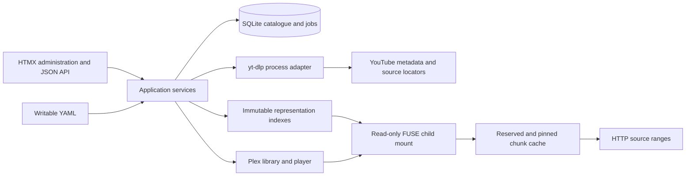

# Architecture

`SourceAdapter` separates enumeration, metadata retrieval, and source resolution.
`Representation` has immutable identity, exact size, and offset reads;
`MediaRepresentation` also describes container, codecs, dimensions, and duration.
`ChunkStore` owns reservations, fetch deduplication, atomic publication, pins, and
eviction. `PlexAdapter` checks actual integration capabilities, scans only a ready
mount, and records bindings independently of source identities.

The durable catalogue stores channels, videos, metadata revisions, broadcast
states, representations, sync jobs, and Plex bindings. A complete refresh commits
in one SQLite transaction. Stable channel IDs determine directory names. Each
eligible new recording receives a persistent year and episode slot. Titles do
not determine identity or path. NFO uses generic YouTube IDs instead of invented
television database identities.

The packaging layer accepts finite progressive combined MP4 or supported separate
MP4 audio/video tracks, including indexed finite fragmented tracks. mp4ff provides
container structures. duplex builds and verifies the sample tables and output to
source range mapping. It stores generated headers and source-bound spans. It
never changes an open handle's map. Unsupported codecs/containers and malformed
or discontinuous inputs fail rather than falling through to a full-file download.

Bounded background workers resolve and verify recordings before publication.
The FUSE tree switches atomically to a complete snapshot. Existing handles retain
their original representation after metadata refresh, window changes, or removal.
New handles see the current verified snapshot. A stable public parent is mounted
into Plex; the FUSE child can be replaced without replacing that parent bind.

The administrator is a single account with a salted PBKDF2-SHA256 credential.
Sessions use random opaque cookies, HttpOnly and SameSite=Strict, with CSRF tokens
and origin checks. The default Compose ports bind to loopback. For administration from another computer, use an SSH tunnel to the loopback
listener. The application checks the actual request origin; it does not trust
forwarded protocol headers. Secrets
remain outside YAML, and signed locators remain process-local.
